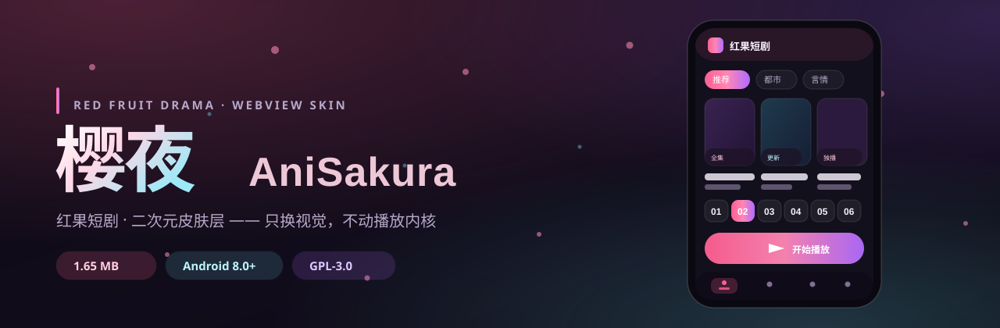
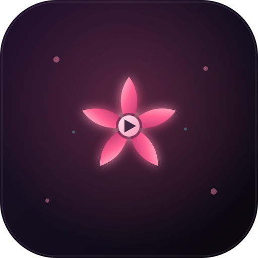

<div align="center">



# 樱夜 AniSakura

**给「红果短剧」Android 客户端做的一套二次元皮肤层 —— 只换视觉，不动播放内核。**


[下载安装](#-下载与安装) · [改了什么](#-改了什么) · [主题原理](#-主题原理) · [自行构建](docs/BUILD.md) · [改配色](docs/SKIN.md)



</div>

---

## 这是什么

[红果短剧](https://github.com/skydeadpeng/hongguo-android-cast) 的 Android 客户端是一个约 1.65 MB 的 WebView 壳：界面是 HTML/React，播放和网络鉴权在 Kotlin 原生层，所以装完很小、打开很快，但**默认界面是一套几乎没有设计的基础样式**。

本仓库以**视觉覆盖层**为主改法：新增一层 `theme-anime.css` 重做配色与质感，另外补了启动页、图标和播放页全屏控件，把界面重做成二次元风：

- 深紫黑底 + 樱花粉主色 + 霓虹青强调
- 玻璃拟态顶栏 / 底栏，选中态带径向光
- 海报卡圆角 18px、渐变描边、悬浮粉光、底部暗角
- 选集按钮胶囊化，当前集整块渐变发光
- 播放按钮渐变 + 呼吸光；海报网格逐个上浮淡入
- 窄体重字重的数字排版，标签紧贴海报

> 片源解析、鉴权、投屏、下载、云同步逻辑与上游 `0.12.80` 一致；差异集中在视觉层与播放页的全屏控件。

## 截图

<div align="center">

<sub>▲ 上图为按本项目配色与尺寸绘制的界面示意（矢量图，非实机截图）</sub>
</div>

实机截图还在补。想补自己的截图：装好后截三张（首页 / 详情选集 / 播放中），放进 `docs/images/` 并在 README 里替换上面这张。

## 下载与安装

| 项 | 值 |
|---|---|
| APK | [`release/Hongguo-0.12.80-ani7-phone-release.apk`](release/Hongguo-0.12.80-ani7-phone-release.apk)（2.19 MB，仓库内直链） |
| 包名 | `io.github.jackotom.hongguo.android` |
| 版本 | `0.12.80-ani7`（versionCode 103） |
| 支持 | Android 8.0（API 26）及以上，targetSdk 35 |
| 架构 | universal（无 `.so`，全架构通用） |

**安装前请先卸载旧的红果客户端**：本项目用调试证书签名，与上游发布包证书不同，包名相同会导致「签名冲突 / 解析失败」。卸载会清掉本机收藏与观看记录。

安装：下载 APK → 允许「安装未知来源应用」→ 安装。

## 改了什么

### 视觉层（不动业务逻辑）

```diff
  src/android/main.jsx
  import './style.css';
+ import './theme-anime.css';
```

| 文件 | 作用 |
|---|---|
| `src/android/theme-anime.css` | 新增。深色 token 覆盖、玻璃拟态、海报卡、选集态、入场动效，以及 `#root` 透明收口 |
| `src/android/public/startup.css` + `public/splash.png` + `src/android/index.html` | 启动加载页：深紫底 + 贴纸 + 加载点 |
| `android/app/src/main/res/values{,-night}/styles.xml` | 固定深色窗口背景与状态栏，消除启动白闪 |
| `android/app/src/main/res/drawable-nodpi/app_icon.png` | 应用图标 |

`style.css`（55 KB 原始样式）与 `App.jsx`（130 KB 业务组件）**一行未改**，随时可拉上游新版覆盖。

### 体验修补（改了两处原生/逻辑代码）

| 文件 | 作用 |
|---|---|
| `android/.../PlayerActivity.java` | 播放页真全屏：全屏按钮、跟随重力、全屏控制条（进度 / 上一集 / 暂停 / 下一集 / 裁切）、全屏常亮 |
| `src/android/search-fallback.mjs` | 搜索按标题相关度重排（完全一致 > 前缀 > 包含 > 逐字 > 部分重合） |

**未改动**：片源解析、鉴权、投屏、下载、云同步逻辑。

## 主题原理

三个关键点，理解了就能自己改：

1. **原样式用 CSS 变量**：`style.css` 的 `:root` 定义 `--bg / --primary / --accent / --text …`。皮肤层把同一批变量重新赋值，绝大部分界面自动跟着变。
2. **原样式默认是浅色**（`--bg:#f5f5f7`），只有 `prefers-color-scheme: dark` 才切深色。系统浅色的手机就会看到大片白底 —— 所以皮肤层直接把 `:root, [data-theme="dark"], [data-theme="light"]` 三种情况都锁成深色 token。
3. **只覆盖、不改结构**：靠 `类名 + 属性选择器`（如 `.poster-art`、`.episode-grid > button[aria-pressed="true"]`）加圆角、描边、渐变、阴影、动效，不新增 DOM。

改配色只需要动 `theme-anime.css` 顶部的十来个变量，见 [docs/SKIN.md](docs/SKIN.md)。

## 自行构建

需要 Node ≥ 22.12、JDK 17、Android SDK 35、Gradle 8.13。完整图文步骤（含国内镜像、签名、常见报错）见 **[docs/BUILD.md](docs/BUILD.md)**。

最短路径：

```bash
npm ci
npm run build:android:ui                       # React → android/app/src/main/assets/web/
gradle -p android assemblePhoneRelease \
       -PhongguoReleaseSigning=compatible      # 用本机 debug keystore 签名
# 产物：android/app/build/outputs/apk/phone/release/app-phone-universal-release.apk
```

推 tag 时 GitHub Actions 会自动构建并附加到 Release，见 [.github/workflows/build-apk.yml](.github/workflows/build-apk.yml)。

## 目录结构

```
├── src/android/
│   ├── theme-anime.css     # ★ 皮肤覆盖层（配色/质感/动效）
│   ├── public/
│   │   ├── startup.css     # 启动加载页样式
│   │   └── splash.png      # 启动页贴纸
│   ├── index.html          # 启动页结构 + theme-color
│   ├── search-fallback.mjs # 搜索相关度重排
│   ├── style.css           # 上游原始样式（勿改）
│   ├── App.jsx             # 上游业务组件（勿改）
│   └── main.jsx            # 仅新增一行 import
├── android/
│   ├── app/build.gradle                 # 版本号 / 签名开关
│   └── app/src/main/
│       ├── java/.../PlayerActivity.java # 播放页全屏控件
│       └── res/
│           ├── values{,-night}/styles.xml  # 固定深色主题
│           └── drawable-nodpi/app_icon.png # 应用图标
├── docs/
│   ├── BUILD.md            # 构建手册
│   ├── SKIN.md             # 主题定制说明
│   └── images/             # banner / icon（手绘 SVG）
└── .github/workflows/      # CI：打 tag 自动出 APK
```

## 兼容性说明

- 主题层依赖上游现有类名。上游大改类名时需要同步更新选择器（一般只是补几条规则，不会失效整个皮肤）。
- 已处理浅色/深色系统设置：**无论系统是哪种，界面都是深色**（这是刻意的，浅色下白色底会破坏观感）。
- `prefers-reduced-motion` 已适配，关掉动画后不做入场与呼吸效果。
- TV 端（`.tv-layout`）保留了遥控器焦点框，未做破坏性改动。

## 致谢与许可

- 上游：[`skydeadpeng/hongguo-android-cast`](https://github.com/skydeadpeng/hongguo-android-cast)（GPL-3.0），本项目是它的衍生作品。
- 更上游：[`jackotom/hongguo-drama`](https://github.com/jackotom/hongguo-drama)。
- 本项目同样以 **GPL-3.0** 发布，见 [LICENSE](LICENSE)；分发时须保留上游版权声明与同样许可。

## 免责声明

本项目是**非官方第三方客户端皮肤**，与红果短剧、黄果漫剧及其运营方无任何关联，未获其授权或认可。项目仅用于学习 Android WebView、React 样式工程与开源协作流程；所有影视内容与商标归各自权利方所有。请自行判断所在地区法律与服务条款后使用，因使用产生的任何后果由使用者承担。

<div align="center"><sub>如果这个皮肤让你少看两眼丑界面，给个 ⭐ 就行。</sub></div>
